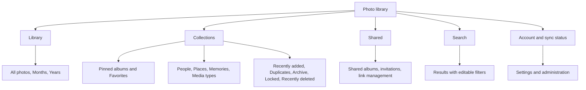
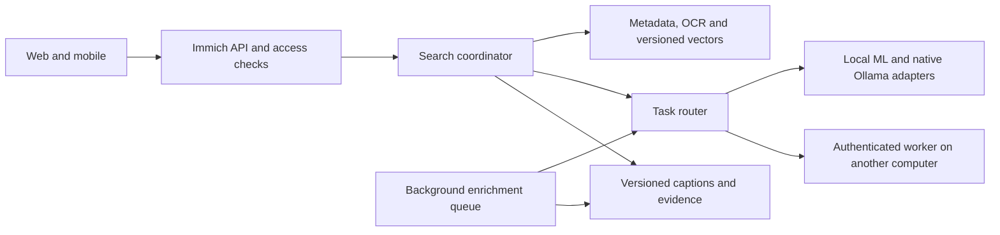

# Photo library experience roadmap

Build a personal photo library that feels calm, immediate, and familiar to someone who loves Apple Photos. Combine that experience with strong natural-language retrieval, useful organization, dependable sharing, and control over originals and AI processing.

Apple's design language is the visual and interaction reference. Keep Immich's self-hosting, broad media support, and existing backend. Start with the desktop web experience on Mac, carry the same information architecture into Flutter, and adapt controls to each platform. A native desktop rewrite is outside the first release.

## Product decisions

1. Photos take visual priority. Navigation is restrained, and photo viewing gets the largest possible canvas.
2. Everyday use requires four concepts: Library, Collections, Shared, and Search. Storage engines, model names, and job queues belong in settings.
3. Search accepts natural language and exposes editable interpretations. People, dates, and locations remain explicit filters that the user can correct.
4. AI is optional and improves an already usable library. Browsing, organization, metadata search, and media playback continue when a model service is unavailable.
5. AI may run on the Immich server, natively on the same Mac, or on another trusted computer. The chosen execution location never changes the basic interaction model.
6. Preserve the originals, existing relationships, and user corrections. AI suggestions carry provenance and remain distinct from user-authored metadata.

The inspiration is Apple's clarity and interaction quality, Google's emphasis on finding photos, editing workflows that make originals recoverable, and Immich's ownership model. These are design goals rather than a promise of feature parity with every product.

## Findings in the current experience

| Area        | Current source or observed behavior                                                                                                     | Proposed change                                                                                                                                               |
| ----------- | --------------------------------------------------------------------------------------------------------------------------------------- | ------------------------------------------------------------------------------------------------------------------------------------------------------------- |
| Navigation  | The web sidebar spreads discovery, people, map, albums, sharing, and utilities across multiple destinations and preferences.            | Group these into a small primary structure with customizable pinned collections. Preserve existing deep links.                                                |
| Web header  | Search shares the header with upload, theme, notifications, account, and potentially casting controls.                                  | Keep search, import, and account/status prominent. Show contextual actions only when relevant; put appearance in settings.                                    |
| Web styling | The application imports an external `@immich/ui` theme, uses GoogleSans, and retains legacy color variables alongside newer components. | Introduce a fork-owned token layer and component wrappers, then remove inconsistent legacy styling incrementally.                                             |
| Mobile      | Flutter uses Material 3; its tabs are Photos, Search, Albums, and Library.                                                              | Align the content structure with the web and build platform-adaptive presentation. Preserve Android conventions where they help navigation and accessibility. |
| Discovery   | The public Explore view already presents People, Places, and Memories.                                                                  | Reuse that content inside Collections rather than create another competing home screen.                                                                       |
| AI settings | Model and infrastructure controls are exposed together; built-in search, faces, and OCR already have separate tasks.                    | Offer understandable quality and processing-location presets, with task-level settings under Advanced.                                                        |

Source entry points: [UserSidebar](../web/src/lib/components/shared-components/side-bar/UserSidebar.svelte), [NavigationBar](../web/src/lib/components/shared-components/navigation-bar/NavigationBar.svelte), [app.css](../web/src/app.css), [mobile tabs](../mobile/lib/pages/common/tab_shell.page.dart), [mobile theme](../mobile/lib/theme/theme_data.dart), and [ML settings](../web/src/routes/admin/system-settings/MachineLearningSettings.svelte). Visual reference: [public demo](https://demo.immich.app/).

## Navigation and screen hierarchy

On desktop, Library, Collections, and Shared live in a compact collapsible sidebar; the global search field opens the Search destination. On phones, all four destinations fit in a bottom tab bar. Tablet layouts gain an adaptive sidebar. Keep route identity, Back behavior, and selection consistent across these presentations.

Collections has a short default order: Favorites, pinned albums, People, Places, Albums, Memories, and media types. Let people reorder or hide sections. Utilities remain one tap away from the Collections index; they should not disappear into an unlabelled overflow menu. Archive and Locked remain distinct because their access semantics differ. Pet identities become a collection only after a dedicated, evaluated implementation exists.

Shared has two clear sections: Shared with me and Shared by me. Album actions expose members, permission level, and link expiry in one place. Existing sharing enforcement remains authoritative; the navigation refresh does not change access rules.

## Visual language

Use Apple's [materials guidance](https://developer.apple.com/design/human-interface-guidelines/materials) as a reference for separating navigation from content. Use translucent material sparingly on chrome, with opaque high-contrast fallbacks. Photo tiles, editing surfaces, and long text do not need glass effects. Reference [navigation and search guidance](https://developer.apple.com/design/human-interface-guidelines/navigation-and-search) for stable destinations and contextual search.

The following are proposed fork tokens, not copied Apple specifications:

| Element     | Starting specification                                                                                                                                  |
| ----------- | ------------------------------------------------------------------------------------------------------------------------------------------------------- |
| Typography  | System font stack on web; platform system typography on mobile. Body 16–17 px, secondary text at least 13 px, clear 28–34 px page titles, all scalable. |
| Surfaces    | Neutral off-white and white in light mode; charcoal and near-black in dark mode. Use semantic surface, text, separator, selection, and status tokens.   |
| Accent      | One restrained blue accent for navigation, focus, and primary actions; reserve red and amber for meaningful states.                                     |
| Spacing     | A 4 px base with 8, 12, 16, 24, and 32 px layout steps.                                                                                                 |
| Shape       | Approximately 12–20 px for panels, small 2–4 px photo-grid corners, and rounded controls only where function supports them.                             |
| Iconography | One consistent icon family per platform, with text labels for ambiguous actions. Use assets cleared for each platform.                                  |
| Motion      | Short 120–220 ms transitions for orientation and feedback; honor reduced motion and avoid heavy blur during scrolling.                                  |
| Density     | Comfortable and Compact options. Persist grid density, sidebar state, and scroll position without affecting the photo's original aspect ratio.          |

Meet [WCAG 2.2 AA](https://www.w3.org/TR/WCAG22/) for the web. Verify text contrast, visible unobscured focus, keyboard operation, target size, and screen-reader names. Use a stronger product target of 44 CSS px for primary web touch controls, scaled mobile touch targets, and layouts that remain usable at 200% text zoom. Support increased contrast, reduced transparency, reduced motion, light/dark mode, and right-to-left layouts. Do not infer accessibility from appearance alone.

## Core journeys

### Bring an existing library

Offer a short setup path: connect to the server, choose an import source, preview the import summary, and choose AI processing location and quality. Separate owner administration from the invitation flow for a family member. Returning users should land in their library rather than repeat setup.

Start with normal files, Apple Photos exports, and Google Takeout archives. Reuse compatible import utilities where possible and make any new archive/sidecar parser an explicit work item. Apple documents exporting unmodified originals and metadata; this does not imply that this fork can directly synchronize an iCloud Photos library. [Apple export guidance](https://support.apple.com/guide/photos/export-photos-videos-and-slideshows-pht6e157c5f/mac).

Preview how originals, edits, paired video, dates, captions, and albums will map before committing an import. Resume interrupted imports and report duplicates and unsupported files separately. Define supported EXIF/IPTC/XMP mappings and test export/reimport with a fixture corpus, using the current [IPTC Photo Metadata standard](https://iptc.org/std/photometadata/specification/IPTC-PhotoMetadata) as the descriptive-metadata reference. Preserve original bytes and report fields that cannot round-trip; file modification time must not silently replace a known capture date.

### Open and browse

Open directly into the last Library position. Show recent photos immediately from available cache while the library refreshes. Keep a stable All photos, Months, Years control, with pinch/zoom or a density control that preserves the visible anchor. Import and refresh must not reset scroll position or shift the selected image.

Keep the virtualized timeline and progressive thumbnails. Use skeletons with correct aspect ratios, cancel obsolete requests during fast scrolling, and preload only a small directional window. Test on both a dense daily library and a sparse multi-decade collection.

### View and edit

Open a photo against a neutral dark canvas, fit to the viewport by default. Keep Close, Favorite, Share, Edit, and Info discoverable; move secondary operations into a labelled More menu. Hide chrome during uninterrupted viewing and restore it predictably on interaction. Space and arrow keys, swipe navigation, pinch zoom, and Escape must have consistent outcomes.

The Info panel groups capture metadata, people, location, and generated descriptions. Editing preserves the original and provides Revert. Treat Live Photo pairs, RAW plus JPEG, bursts, stacks, orientation, and color profiles as explicit media cases. A re-skin must not separate paired assets or flatten an original into an edited preview.

### Find a photo

Use one field for text, people, dates, locations, and visual descriptions. For “Sarah blowing out candles last year,” show chips for Sarah, the resolved date range, and the visual phrase. If multiple people match Sarah, ask the user to choose. Resolve relative dates deterministically using the user's locale and timezone after extracting intent.

Return an initial ranked grid without waiting for optional expensive image inspection. Offer refinement when needed. Avoid reshuffling a grid under an active selection. Keep Recent searches local or user-scoped and allow clearing them. Saved searches become smart collections with explicit, inspectable rules.

Natural-language convenience builds on the same filters available manually. Empty, unsupported, or ambiguous interpretations must never silently remove a person's requested constraint. Recognized identities come from Immich's named people; a vision-language model does not assign names to faces.

### Organize and share

Make album creation available from selection and Collections. Support clear selection counts, drag-and-drop on desktop, keyboard selection, and accessible alternatives to dragging. Suggestions such as an event or duplicate group remain reviewable before they change the library.

Sharing shows the destination and audience before publishing. Copy link, Invite, and Stop sharing belong together. Keep account, partner-sharing, and shared-link rules intact. A collection of generated search results must recheck access before displaying media or sharing it.

### Understand sync and processing

Use a quiet account indicator for Synced, Uploading, Paused, Offline, or Needs attention. Show the affected items and a repair action rather than a permanent queue dashboard. Call an upload “Synced to your server”; do not imply that this alone proves an independent backup exists.

Track Uploaded, Preview ready, Search ready, and Enhanced separately. A photo can be browsable before richer AI processing completes. A sleeping remote computer should produce “Enhanced search unavailable; basic search still works” rather than an empty library.

## AI execution architecture

Keep Immich authoritative for assets, authorization, albums, people, and media delivery. Add backend services for validated query plans, enrichment records, and task routing. The same services should support web and mobile; do not leave the feature as a separate companion-only experience.

Settings offers **This computer**, **Another computer**, or a deliberate task-by-task combination. “This computer” means the server/worker host, not automatically the phone being used. Test the connection, discover capabilities, show the selected model and processing location, and allow removal. Use separate adapters for Immich's existing ML API, Ollama generation, and future embedding/reranking services. An OpenAI-compatible endpoint is a protocol option, not a guarantee that every image, embedding, or structured-output feature is supported.

Remote workers need authenticated transport, a scoped worker identity, least-necessary previews, a versioned capability contract, and observable health. Preserve an explicitly configured local fallback. If no permitted compatible fallback exists, degrade the feature; do not silently send private photos to an external provider. Internet-hosted providers, if added later, require a separate visible processing choice.

Reserve capacity for interactive retrieval. Run enrichment with bounded concurrency, resumable jobs, idempotent output keys, and retry/backoff. Use the fork's current dedicated-search endpoint and deadline support where appropriate, while recognizing that separate processes on the same Mac still share memory and compute. HTTP cancellation does not guarantee that an inference already running on a worker stops.

Store model revision, weight checksum, preprocessing/tokenizer version, vector dimension and normalization, precision, prompt version, asset revision, and evidence source. Keep face, image/text, and caption vectors in their own compatible spaces. Use a new index beside the old one during model evaluation; preserve person identities and user corrections across migrations. Switching a search model also requires duplicate-threshold calibration because current near-duplicate detection uses its embeddings.

On the 16 GB development Mac, keep native Ollama available for Apple GPU acceleration and begin with one enrichment inference at a time. The ML source also includes a CoreML execution-provider path; validate that native path rather than assume new backend support must be invented. Apple's GPU is not automatically available inside the Linux Docker VM. Document a low-memory profile and a stronger remote-worker profile. [Ollama hardware support](https://docs.ollama.com/gpu), [ML provider implementation](../machine-learning/immich_ml/sessions/ort.py).

## Delivery phases

Effort bands are planning estimates for one experienced contributor: S is a few engineer-days, M is roughly one to two engineer-weeks, and L is multiple engineer-weeks. They are not release-date commitments. Backend/provider work can progress alongside the visual work after the contracts are agreed.

| Phase | Deliverable and code entry points                                                                                                                                                                          | Dependencies                     | Exit criteria                                                                                                                                                                                | Effort |
| ----- | ---------------------------------------------------------------------------------------------------------------------------------------------------------------------------------------------------------- | -------------------------------- | -------------------------------------------------------------------------------------------------------------------------------------------------------------------------------------------- | ------ |
| 0     | Baseline journeys, performance traces, route map, representative media fixtures, and model evaluation corpus. Use `e2e/src/ui` and existing monitoring.                                                    | Existing fork                    | Repeatable measurements on Mac and a remote-worker configuration; agreed MVP task list.                                                                                                      | S–M    |
| 1     | Fork-owned tokens, UI wrappers, adaptive app shell, and navigation preferences. Start in `web/src/app.css`, `UserPageLayout.svelte`, `NavigationBar.svelte`, and `UserSidebar.svelte`.                     | Phase 0                          | Library, Collections, Shared, and Search shells work in both themes with keyboard and screen-reader navigation.                                                                              | M      |
| 2     | Library and viewer refresh, selection, contextual actions, and sync status. Preserve timeline and asset-viewer managers.                                                                                   | Phase 1                          | Browse, select, view, import, favorite, edit/revert, and return to the same scroll anchor without regression.                                                                                | L      |
| 3     | Collections, albums, sharing clarity, import setup, editable search chips, and saved-search contracts. Start in existing search components and routes.                                                     | Phases 1–2                       | Users complete the principal journeys without visiting administration; existing URLs and permissions still work. Import scope and any new archive parsers have explicit acceptance fixtures. | L      |
| 4     | Provider settings and task router, model manifests, resumable enrichment records, and side-by-side index lifecycle. Extend `server/src/services`, repositories, ML schemas, and generated SDKs together.   | Phase 0 and agreed UI contracts  | Local-only and remote-only configurations pass capability, failure, permission, and migration tests.                                                                                         | L      |
| 5     | Native Gemma query planning and captions; evaluated embedding/OCR profiles; optional shortlist reranking.                                                                                                  | Phases 3–4 and model gates       | Search quality improves on the held-out corpus while latency, memory, and ordinary browsing remain within budget.                                                                            | L      |
| 6     | Flutter presentation parity, platform adaptations, offline states, accessibility, and upgrade rehearsal. Start in `mobile/lib/theme`, the tab shell, `mobile/packages/ui`, and viewer/search presentation. | Stable contracts from phases 1–5 | Common journeys pass on phones and tablets; Android stays usable and idiomatic; server upgrade and rollback rehearsed.                                                                       | L      |

Keep each implementation change small enough to review. Start with an app-shell PR, then a library/viewer PR, then Collections and Search. Use an appearance feature flag and per-user preference during the rollout. Map existing preferences to the new structure; preserve bookmarks, album IDs, scroll state, and mobile deep links.

The shared web UI comes from an external `@immich/ui` package. Prefer a fork-owned token/adapter layer first; pin or fork the package only when component behavior requires it. Never patch `node_modules`. Generate web and Dart SDK changes from the API contract when backend endpoints change. Retain upstream attribution and keep operational and licensing information accessible in About/settings.

Keep the product plan and implementation on reviewable branches. Track upstream fixes continuously and periodically rehearse an update against a pinned upstream release, including database migrations and client compatibility. Prefer a small number of explicit extension points to copying entire backend services. Broader branding, app-store distribution, and a native Mac client are separate decisions; they should not block the first useful visual refresh.

## Release gates

These are proposed acceptance budgets. Phase 0 must establish the reference hardware, browser, network, library size, and current measurements before they become release gates.

| Measure                          | Initial target                                                                                                                                                                   |
| -------------------------------- | -------------------------------------------------------------------------------------------------------------------------------------------------------------------------------- |
| Routine navigation and scrolling | No more than 10% regression against the baseline under concurrent import; aim for 60 Hz scrolling on the reference device.                                                       |
| Initial web loading              | LCP at or below 2.5 seconds at the 75th percentile under the agreed reference conditions.                                                                                        |
| Web interaction                  | INP at or below 200 ms at the 75th percentile for measured journeys; separately track p95 and slow-device results.                                                               |
| First searchable results         | Warm standard retrieval p95 at or below 1 second on the reference LAN; complex planned search initially targets 3 seconds. Optional enrichment must not block initial results.   |
| Layout stability                 | CLS at or below 0.1 for core web screens; import and refinement preserve the selected asset and visible anchor.                                                                  |
| Usability                        | At least 90% completion of find, album, share, import-status, and edit/revert tasks in formative testing; no critical data-loss or permission misunderstandings.                 |
| Search quality                   | Compare Recall@20 and nDCG@10 against the current model with confidence intervals. Prefer a meaningful quality gain or a material latency/memory saving with equivalent quality. |
| AI availability                  | Local-only, remote-only, and permitted-fallback tests pass; a failed worker never blocks Library or silently changes the processing destination.                                 |
| Accessibility and media          | Manual keyboard/VoiceOver/TalkBack checks plus automated checks; a fixture matrix covers color, orientation, Live Photos, RAW, HEIC, HDR, and long video.                        |

The LCP, INP, and CLS thresholds align with published [Web Vitals guidance](https://web.dev/articles/vitals). The remaining numbers are proposed product targets, not measured results or outside standards.

## First release scope

Ship the new shell, Library/viewer, Collections organization, sharing clarity, and unified search controls. Make local and remote processing first-class settings and introduce the first evaluated Gemma-backed search capability behind a feature flag. Keep the existing search path available throughout rollout.

Pet identity recognition, automatic event narratives, speech/video moment search, a native Mac client, and generative photo editing belong in later releases. Each requires its own quality and performance evidence. The immediate next implementation step is the token layer and app shell, using this roadmap and the [model review](ai-model-review.md) as the shared specification.
